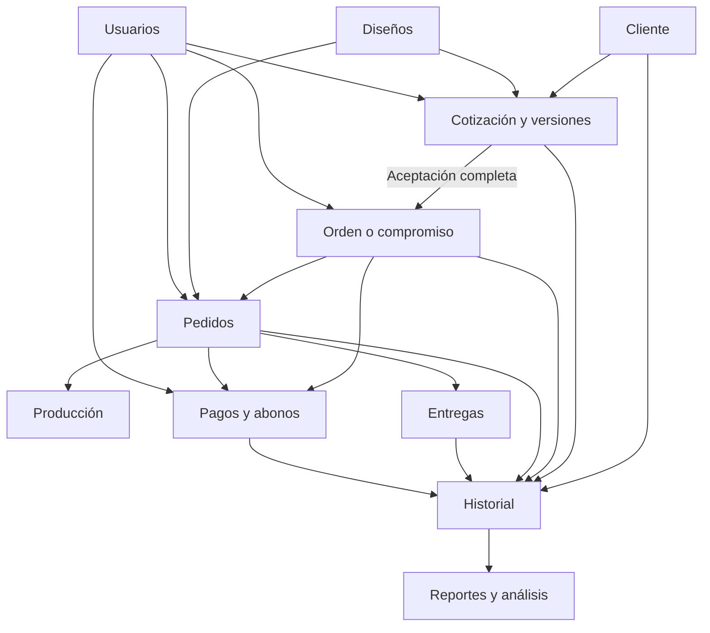

# CL01.01.01 — Concepto y propósito de la arquitectura

**Proyecto:** sistema de gestión integral del negocio de bordados  
**Clase curricular:** CL01.01.01 — Concepto y propósito de la arquitectura  
**Estado de la clase:** objetivos de aprendizaje trabajados y completados; consolidación del diagnóstico  
**Alcance de este documento:** diagnóstico de alto nivel. No constituye una arquitectura técnica aprobada ni autoriza cambios de implementación.

## 1. Seguimiento de los objetivos oficiales

Los seis objetivos de la ficha curricular fueron trabajados con el sistema del negocio de bordados como caso de aplicación. El estado se refiere al aprendizaje demostrado durante las sesiones, no a que el sistema ya implemente las capacidades descritas.

| # | Objetivo oficial | Estado | Evidencia de aprendizaje |
|---|---|---|---|
| 1 | Explicar qué es la arquitectura de software y qué problema práctico ayuda a resolver. | **Cubierto** | Se explicó la arquitectura como una forma de comprender elementos, propiedades externamente visibles y relaciones, anticipar incompatibilidades y razonar sobre la evolución del sistema. |
| 2 | Distinguir una descripción arquitectónica de una lista de funciones, tecnologías y código. | **Cubierto** | Se distinguió la organización conceptual del sistema y sus relaciones de las tecnologías y detalles de implementación. Se identificó que enumerar pantallas o funciones no explica cómo encajan las partes. |
| 3 | Reconocer elementos, relaciones y propiedades externamente visibles. | **Cubierto** | Se identificaron clientes, diseños, cotizaciones, órdenes, pedidos, producción, entregas, pagos, usuarios e historial; también relaciones como cotización aceptada → orden → pedidos, y propiedades que condicionan a otros elementos, por ejemplo importes, cantidades, estados, vigencia y datos del diseño acordado. |
| 4 | Explicar la arquitectura como abstracción que selecciona detalles relevantes y omite otros. | **Cubierto** | Se justificó que una vista dedicada al proceso de cotización debe mostrar clientes, diseños y precios, pero no órdenes, pedidos y pagos si estos no ayudan a responder esa pregunta. Se distinguió omitir un detalle de negar su existencia o importancia. |
| 5 | Relacionar decisiones estructurales con atributos de calidad y compromisos. | **Cubierto** | Se relacionó la centralización de reglas de cálculo con exactitud y consistencia; la autorización con seguridad; y el bloqueo de edición con integridad frente a concurrencia. Se identificó el coste de reducir la edición simultánea. |
| 6 | Identificar por qué no existe una arquitectura óptima universal y por qué las decisiones dependen del contexto. | **Cubierto** | Se compararon escenarios de diferente escala y se reconoció que presupuesto, experiencia del equipo, tiempo, carga, crecimiento, disponibilidad, requisitos legales y capacidad operativa condicionan las alternativas. Se concluyó que aún falta información para elegir una arquitectura futura. |

**Resultado:** los seis objetivos de aprendizaje están cubiertos en el plano formativo. Esto no significa que las decisiones técnicas futuras estén resueltas.

## 2. Propósito del sistema

El propósito objetivo es gestionar integralmente el negocio de bordados: desde la cotización hasta la aceptación del trabajo, organización de pedidos, producción, entregas, cobros y análisis posterior.

El sistema debe ayudar a mantener información coherente durante todo el ciclo comercial y operativo, conservar el historial necesario para entender qué se ofreció y qué se comprometió, y permitir consultar el comportamiento de los clientes y del negocio.

Este propósito futuro es más amplio que el alcance actualmente implementado.

## 3. Sistema actual: hechos observados

El diagnóstico técnico previo se realizó mediante inspección estática del repositorio, sin modificar código ni ejecutar pruebas durante ese diagnóstico. La referencia inspeccionada fue el commit `c7dc88f6c87e09f3e5c38dc091f3a498a57aadf3`.

- Aplicación local desarrollada en Python y Streamlit.
- Persistencia mediante SQLite.
- Organización en áreas como `views`, `services`, `models`, `repositories`, `exports`, `tests` y `specs`.
- Funcionalidad identificada para clientes, diseños, configuración, cotizaciones e historial de cotizaciones.
- Servicios de cálculo y reglas de dominio; repositorios para acceso a datos; exportación PDF y CSV.
- La pantalla de cotización concentra una parte importante del flujo de captura, cálculo, validación, preparación de datos y persistencia.
- Se identificaron contratos/modelos llamados `Order`, `Payment` y `User`; su presencia no demuestra que existan flujos funcionales completos de pedidos, pagos o autenticación.
- La documentación en `specs/pedidos/` describe requisitos y una propuesta futura; no demuestra que esas capacidades estén implementadas.
- No se encontró evidencia suficiente de una API REST/GraphQL, servicios distribuidos, autenticación externa, integración de pagos ni mensajería.

**Límite de la evidencia:** el diagnóstico estático no demuestra el comportamiento en producción, el despliegue real, la concurrencia efectiva, la capacidad, la disponibilidad, los respaldos ni la recuperación ante fallos. Tampoco equivale a una auditoría completa de seguridad o calidad.

## 4. Sistema objetivo: elementos, relaciones y propiedades relevantes

Los siguientes elementos representan el dominio conceptual que el usuario quiere gestionar. No implican que ya existan como módulos técnicos independientes.

| Elemento | Propósito general | Propiedades o información relevante para otros elementos |
|---|---|---|
| Clientes | Identificar a las personas y consultar su relación comercial con el negocio. | Nombre, apellidos, teléfono, dirección, correo y referencia para ubicar a la persona. |
| Diseños | Identificar el bordado acordado. | Identidad y especificación del diseño; el diseño aceptado no debe cambiar dentro del compromiso existente. |
| Cotizaciones | Presentar una propuesta comercial. | Conceptos, diseños, cantidades, costos/precios, importes, vigencia y versión. |
| Órdenes | Representar el compromiso aceptado que agrupa trabajos. | Pedidos asociados, importes, pagos, saldo y avance general. |
| Pedidos | Representar cada trabajo individual dentro de una orden. | Diseño, cantidad, precio/importe, estado de pago y estado operativo. |
| Producción | Registrar el avance del trabajo. | Estado y progreso de cada pedido. |
| Entregas | Registrar lo entregado al cliente. | Cantidades y entregas parciales o completas relacionadas con los pedidos. |
| Pagos | Registrar pagos y abonos. | Importe, fecha y referencia a la orden y al pedido al que se aplica. |
| Usuarios | Identificar quién utiliza el sistema y realiza operaciones. | Identidad, permisos y autoría de acciones. |
| Historial y reportes | Consultar la trayectoria del cliente y analizar el negocio. | Cotizaciones, pedidos, entregas, pagos, cambios y datos agregados. |

### Relaciones conceptuales identificadas

- Una cotización contiene conceptos relacionados con diseños y cantidades.
- La cotización se acepta como una propuesta completa; si el cliente quiere cambiar conceptos antes de aceptar, se prepara una nueva versión.
- Una cotización aceptada puede dar lugar a una o varias órdenes; esta posibilidad se discutió como modelo conceptual, pero la distribución de importes entre varias órdenes sigue pendiente.
- Una orden agrupa uno o varios pedidos.
- Cada pedido corresponde a un diseño y una cantidad determinados.
- Cada pedido mantiene un estado operativo y un estado de pago independientes.
- La orden permite consultar el resultado financiero y operativo conjunto de sus pedidos.
- Los pagos pueden aplicarse a una orden y a los pedidos correspondientes; la regla exacta de distribución de pagos aún requiere definición.
- Los pedidos pueden avanzar y entregarse parcialmente.
- El historial relaciona la actividad del cliente con cotizaciones, órdenes, pedidos, entregas y pagos.

El diagrama es una representación de conceptos y relaciones del negocio. No especifica interfaces, protocolos, procesos, despliegue ni componentes de runtime.

## 5. Preocupaciones de calidad y compromisos

| Preocupación | Necesidad expresada | Relación o consecuencia arquitectónica identificada |
|---|---|---|
| Exactitud y consistencia | Evitar errores de costos, precios, cantidades y saldos. | Las reglas de cálculo deben ser coherentes y reutilizables por cotizaciones y pedidos; conservar importes y condiciones de compromisos ya aceptados. |
| Integridad y conservación | Evitar pérdida o corrupción de cotizaciones, pedidos, pagos y demás información. | Las operaciones relacionadas deben mantener datos coherentes; la recuperación y persistencia segura son preocupaciones centrales. |
| Seguridad y privacidad | Evitar consultas y modificaciones no autorizadas de datos, precios, cotizaciones y pagos. | Se necesitan controles de acceso y permisos efectivos; los detalles legales y técnicos no se resuelven en esta clase. |
| Disponibilidad | Poder trabajar desde computadora o celular y recuperar el servicio después de interrupciones. | Se acepta una interrupción temporal si los datos permanecen seguros y recuperables. No se fijó un objetivo medible de disponibilidad. |
| Modificabilidad | Incorporar cambios de procesos y reglas sin reconstruir partes no relacionadas. | La organización debe permitir evolucionar cotizaciones, pedidos, producción y pagos con retrabajo controlado. |
| Rendimiento | Mantener tiempos de respuesta razonables al consultar clientes, cotizar y revisar muchos pedidos. | Hace falta conocer volumen y carga para establecer objetivos y evaluar alternativas. |
| Trazabilidad | Saber quién realizó una operación y cuándo. | Las acciones relevantes deben poder asociarse con un usuario y un momento. |

### Compromiso analizado: integridad frente a concurrencia

Se consideró como ejemplo bloquear una cotización mientras una persona la modifica.

- **Beneficio esperado:** reducir el riesgo de sobrescrituras y cambios concurrentes incompatibles.
- **Coste:** otros usuarios tendrían que esperar, reduciendo la concurrencia y rapidez de edición.
- **Preferencia expresada:** el usuario considera aceptable ese coste si ayuda a proteger la integridad de la información.

Esto registra una preferencia contextual, no una decisión técnica definitiva de implementar bloqueos. La estrategia concreta debe evaluarse cuando corresponda.

## 6. Hechos, hipótesis, decisiones y pendientes

### 6.1 Hechos observados o confirmados

- El sistema actual es una aplicación local Python/Streamlit con SQLite, según la inspección estática citada.
- El alcance funcional comprobado incluye cotizaciones, clientes, diseños, configuración e historial de cotizaciones.
- No se comprobó una implementación integral de órdenes, pedidos, producción, entregas, pagos y autenticación.
- El negocio necesita gestionar el ciclo desde la cotización hasta la entrega y el cobro.
- El usuario requiere acceso desde computadoras y celulares y contempla uso simultáneo.
- Una cotización vigente debe respetar las condiciones ofrecidas aunque cambien los costos de insumos.
- Una cotización vencida deja de garantizar el precio; para continuar se debe emitir una nueva cotización con precios actualizados.
- Los cambios solicitados por el cliente deben conservar el registro anterior y generar una nueva versión/propuesta, en lugar de alterar silenciosamente el compromiso previo.
- La cotización no se acepta parcialmente: si se modifican conceptos antes de aceptar, se prepara una nueva cotización.
- El diseño acordado al aceptar no debe cambiar dentro del compromiso existente.
- El pedido necesita estados de pago y operativos separados.
- Se considera importante conservar trazabilidad de las operaciones.

### 6.2 Hipótesis y modelos conceptuales por validar

- Una cotización aceptada podría generar una o varias órdenes, cada una representando un compromiso específico. Falta validar el caso de negocio y definir cómo se distribuyen importes y condiciones.
- El estado operativo global de una orden podría derivarse del estado de sus pedidos. Falta definir las reglas exactas de agregación.
- Los pagos podrían asociarse a una orden y distribuirse entre pedidos. Falta establecer la regla de aplicación, prioridad y tratamiento de pagos parciales.
- El bloqueo temporal de edición podría ser una estrategia para evitar conflictos, pero no se ha comparado con detección de conflictos u otras alternativas.
- Una arquitectura monolítica podría ser suficiente para una primera etapa; una arquitectura distribuida podría tener sentido bajo determinadas necesidades. Ninguna alternativa está seleccionada.
- El acceso web multiusuario podría requerir cambiar el modelo actual de alojamiento y operación; el alcance del cambio depende de requisitos aún no medidos.

### 6.3 Decisiones y acuerdos expresados por el usuario

- El propósito del sistema es la gestión integral del negocio, no solamente la cotización.
- La cotización aceptada debe conservar las condiciones comerciales acordadas.
- La aceptación de una cotización es completa, no parcial.
- Los cambios antes de la aceptación se manejan mediante una nueva versión de cotización.
- Si el cliente cambia el diseño o las condiciones después de existir un compromiso, se conserva el registro anterior y se genera una nueva cotización y un nuevo compromiso si se acepta.
- La vigencia de la cotización puede configurarse (por ejemplo, 7, 15 o 30 días, o un plazo personalizado); al enviarla, la fecha de vencimiento queda fija.
- Los estados de pago y operativos de los pedidos son independientes.
- La información vigente del cliente debe reflejar sus datos actuales; el usuario no desea conservar copias históricas de los datos personales del cliente en cada cotización/pedido.
- Se prioriza proteger la integridad de la información, incluso si una estrategia de edición reduce la concurrencia.
- Se desea trazabilidad de quién realizó operaciones y cuándo.
- La preferencia inicial es comenzar con el menor gasto posible, sin descartar evaluar nube si evita depender de una PC local.
- No se ha aprobado una arquitectura técnica, plataforma de alojamiento ni estrategia concreta de concurrencia.

### 6.4 Pendientes de información o decisión

Estos puntos se conservan abiertos. No se resuelven en CL01.01.01 ni se convierten en decisiones por aparecer en este documento.

1. **Carga y concurrencia:** número esperado de usuarios simultáneos, operaciones por periodo y patrones de uso.
2. **Crecimiento:** volumen esperado de clientes, cotizaciones, pedidos, pagos, imágenes y años de historial.
3. **Alojamiento:** comparar operación local y nube considerando coste, acceso remoto, dependencia de la PC, mantenimiento y recuperación.
4. **Disponibilidad y recuperación:** tolerancia a interrupciones, pérdida de datos admisible y tiempos esperados de recuperación.
5. **Seguridad y privacidad:** perfiles, permisos, protección de datos, acceso a información y obligaciones legales aplicables.
6. **Capacidad del equipo:** experiencia disponible, tiempo para aprender y capacidad de operar/mantener la solución.
7. **Concurrencia de edición:** decidir entre bloqueo, detección de conflictos u otra estrategia con base en escenarios reales.
8. **Órdenes múltiples por cotización:** confirmar cuándo una aceptación puede originar más de una orden y cómo se distribuyen importes.
9. **Pagos:** reglas de aplicación a órdenes/pedidos, abonos, saldos, devoluciones y conciliación.
10. **Estados y transiciones:** definir los estados y reglas completas de órdenes, pedidos, producción y entregas cuando corresponda.
11. **Archivado y retención:** definir cuánto tiempo conservar registros y bajo qué condiciones permitir eliminación.
12. **Reportes e IA:** concretar necesidades y casos de uso antes de proponer capacidades.
13. **Datos históricos del cliente:** analizar las consecuencias de mantener únicamente datos vigentes frente a la necesidad de reconstruir documentos y compromisos anteriores.

## 7. Clasificación preliminar del diagnóstico

Esta clasificación se limita al nivel de análisis de la clase.

- **Conservar:** el sistema actual de cotizaciones, clientes y diseños como punto de partida y evidencia funcional existente.
- **Corregir:** no se declara una corrección concreta en esta clase; los riesgos detectados requieren análisis y evidencia adicional.
- **Mejorar:** evaluar la concentración de responsabilidades en el flujo de cotización y la consistencia de reglas compartidas, sin prescribir todavía una solución.
- **Rediseñar:** no se aprueba ningún rediseño técnico en esta clase.
- **Pendiente de evidencia:** despliegue real, concurrencia, seguridad, volumen, disponibilidad, recuperación, operación y alcance real de las funciones futuras.

## 8. Conclusiones de CL01.01.01

La arquitectura del sistema debe comprenderse como un conjunto de elementos relacionados y de propiedades que condicionan a otras partes y al negocio. No basta con enumerar funciones, pantallas, tecnologías o archivos: es necesario explicar cómo las partes participan en el ciclo de trabajo y qué consecuencias producen sus relaciones.

El propósito acordado rebasa el cotizador actual. La visión incluye cotizaciones, compromisos, pedidos individuales, producción, entregas, pagos e historial. Las reglas comerciales y la información deben conservar coherencia a lo largo de ese ciclo. Por ello, diseñar cada módulo de forma aislada puede producir incompatibilidades y retrabajo.

La descripción arquitectónica debe ajustarse a la pregunta. Para comprender únicamente la cotización bastan los elementos relevantes para ese proceso, como clientes, diseños y precios; órdenes, pedidos y pagos pueden omitirse en esa vista si no ayudan a responderla. Para explicar el sistema integral, esas relaciones sí son relevantes.

Las preocupaciones principales son exactitud, integridad, seguridad, disponibilidad, modificabilidad, rendimiento y trazabilidad. Las decisiones tienen costes: por ejemplo, bloquear la edición puede proteger la integridad, pero reduce la concurrencia. La conveniencia depende del contexto y de las necesidades reales.

No existe información suficiente para declarar una arquitectura técnica futura como óptima. Antes de elegir entre alternativas locales, monolíticas o distribuidas deben conocerse carga, crecimiento, presupuesto, disponibilidad, seguridad, capacidades del equipo y necesidades operativas. La clase deja esas cuestiones como pendientes, no como decisiones implícitas.

## 9. Límite respecto a la siguiente clase

CL01.01.01 establece el propósito, reconoce elementos y relaciones a nivel introductorio, practica abstracción y relaciona decisiones con preocupaciones de calidad y contexto.

El análisis sistemático de responsabilidades, límites, dependencias e interacciones entre elementos corresponde a **CL01.02.01 — Distinguir elementos, responsabilidades y relaciones**. No se anticipa ni se declara resuelto en este documento.

## 10. Trazabilidad

- **Diagnóstico técnico estático:** repositorio `acuscorp/embroidery-price-estimator`, referencia `c7dc88f6c87e09f3e5c38dc091f3a498a57aadf3`.
- **Ficha curricular:** `CL01.01.01 — Concepto y propósito de la arquitectura`, referencia curricular `034db192b4d48e6b9cacb69aceba601f6bdd182c`.
- **Fuente conceptual principal para la definición y abstracción:** *Software Architecture in Practice*, 3.ª ed., cap. 1, conforme a la ficha curricular.
- Las decisiones y necesidades del sistema objetivo registradas aquí provienen de las sesiones de trabajo con el usuario. Las hipótesis y pendientes están etiquetados para no presentarlos como hechos.
