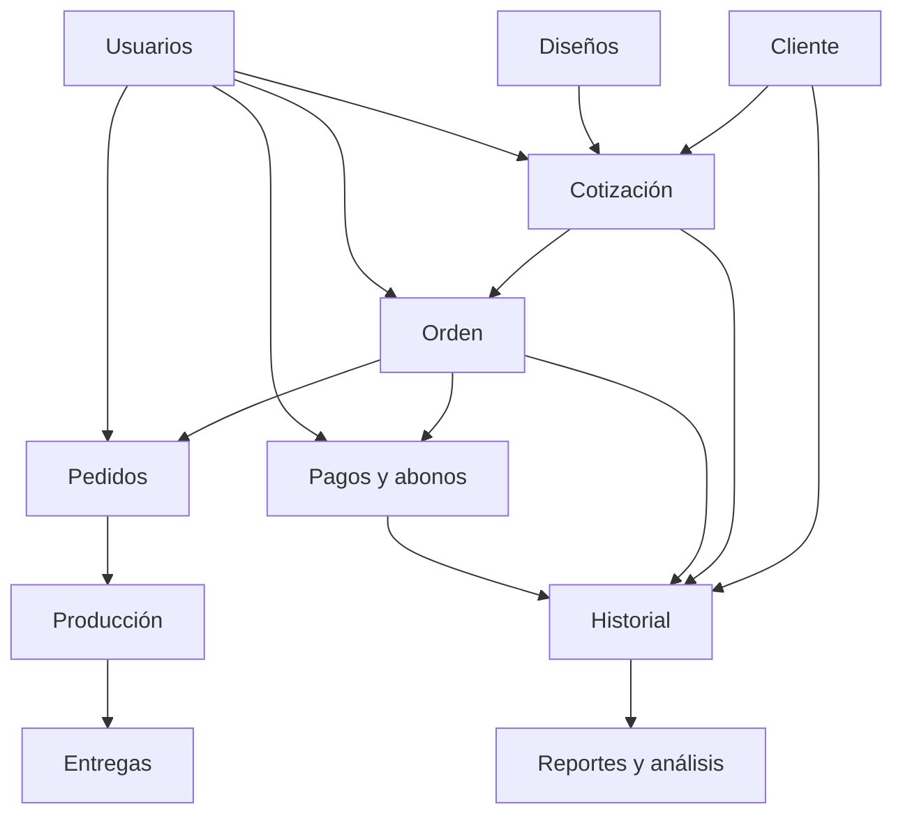

# CL01.01.01 — Concepto y propósito de la arquitectura

**Proyecto:** aplicación de gestión del negocio de bordados (nombre comercial/técnico pendiente)  
**Estado:** análisis de aplicación completado; sujeto a revisión del usuario  
**Clase curricular:** [CL01.01.01 — Concepto y propósito de la arquitectura](https://github.com/acuscorp/SoftwareArchitecture/blob/main/Classes/M01%20-%20Pensamiento%20arquitect%C3%B3nico%20y%20fundamentos/CL01.01.01%20-%20Concepto%20y%20prop%C3%B3sito%20de%20la%20arquitectura.md)

## 1. Propósito

El objetivo futuro es gestionar integralmente el negocio de bordados, desde la cotización hasta la producción, entrega y cobro de los trabajos. El sistema también deberá conservar información histórica para consultas, reportes y análisis posteriores.

Este propósito objetivo es distinto del alcance implementado actualmente.

## 2. Perspectiva actual y objetivo

### Sistema actual — hechos observados

- Aplicación local desarrollada en Python y Streamlit.
- Persistencia SQLite.
- Áreas de clientes, diseños, configuración, cotizaciones e historial.
- Servicios de cálculo, repositorios y exportación PDF/CSV.
- La pantalla de cotización concentra parte importante del flujo de captura, cálculo y persistencia.
- No se ha confirmado implementación integral de órdenes, pedidos, producción, entregas y pagos.

### Sistema objetivo — visión confirmada

- Clientes y diseños.
- Cotizaciones y órdenes aceptadas.
- Pedidos individuales agrupados en órdenes.
- Seguimiento de producción.
- Entregas parciales y completas.
- Pagos, abonos y saldos.
- Usuarios, autorización y trazabilidad.
- Historial, reportes y análisis de datos.
- Acceso web desde computadoras y celulares, con uso simultáneo.

## 3. Elementos y relaciones conceptuales

| Elemento | Responsabilidad prevista |
|---|---|
| Clientes | Información e historial del cliente. |
| Diseños | Catálogo de diseños de bordado. |
| Cotizaciones | Cálculo y propuesta comercial. |
| Órdenes | Compromiso aceptado que agrupa trabajos. |
| Pedidos | Trabajos individuales con seguimiento propio. |
| Producción | Avance de los pedidos. |
| Entregas | Registro de entregas. |
| Pagos | Pagos, abonos y saldos. |
| Usuarios | Identidad y operaciones realizadas. |
| Historial y reportes | Consulta y análisis de información. |

El diagrama expresa relaciones conceptuales del negocio; no es una especificación de interfaces técnicas ni una descripción del runtime actual.

## 4. Preocupaciones de calidad

- **Exactitud:** evitar errores en costos, precios y operaciones financieras.
- **Integridad:** conservar información correcta de cotizaciones, pedidos, entregas y pagos.
- **Disponibilidad:** mantener el sistema accesible durante la operación.
- **Confiabilidad:** ejecutar correctamente las operaciones y controlar los errores.
- **Seguridad:** proteger la información y controlar permisos.
- **Trazabilidad:** identificar quién realizó cambios y cuándo.
- **Consistencia:** mantener reglas de cálculo coherentes entre distintos flujos.
- **Modificabilidad:** facilitar la evolución del sistema sin retrabajo innecesario.

## 5. Contexto conocido

- Acceso deseado mediante navegador desde computadoras y celulares.
- Uso simultáneo por varias personas.
- Interés en identificar al usuario que modifica un registro y evitar conflictos de edición.
- Preferencia inicial por limitar gastos; se evaluará alojamiento local frente a nube.
- Interés futuro en reportes, estadística e inteligencia artificial.

## 6. Pendientes registrados

Estos temas no se deciden en CL01.01.01; se retomarán cuando correspondan en la ruta:

1. Alojamiento local o en la nube.
2. Concurrencia y estrategia de edición simultánea.
3. Política de archivado y eliminación definitiva.
4. Autorizaciones para aprobar modificaciones.
5. Inventario completo de reglas de negocio.
6. Requisitos medibles de disponibilidad, recuperación y volumen.
7. Alcance y diseño de reportes y capacidades de IA.

## 7. Conclusión

La arquitectura debe analizar el sistema como un conjunto de elementos relacionados que soportan el ciclo completo del negocio. Construir cotizaciones, pedidos, producción, entregas y pagos como partes aisladas puede generar incompatibilidades, dependencias no previstas y retrabajo durante la integración.

En esta clase se establece el propósito y se identifican las relaciones y preocupaciones principales. No se aprueba todavía una arquitectura técnica futura ni se prescribe una tecnología de implementación.

## 8. Clasificación

- **Conservar:** sistema actual como punto de partida y evidencia.
- **Corregir / Mejorar / Rediseñar:** no se determina en esta clase.
- **Pendiente de evidencia:** despliegue, concurrencia, seguridad y operación.
- **Decisión aprobada:** propósito de evolución hacia la gestión integral del negocio.
